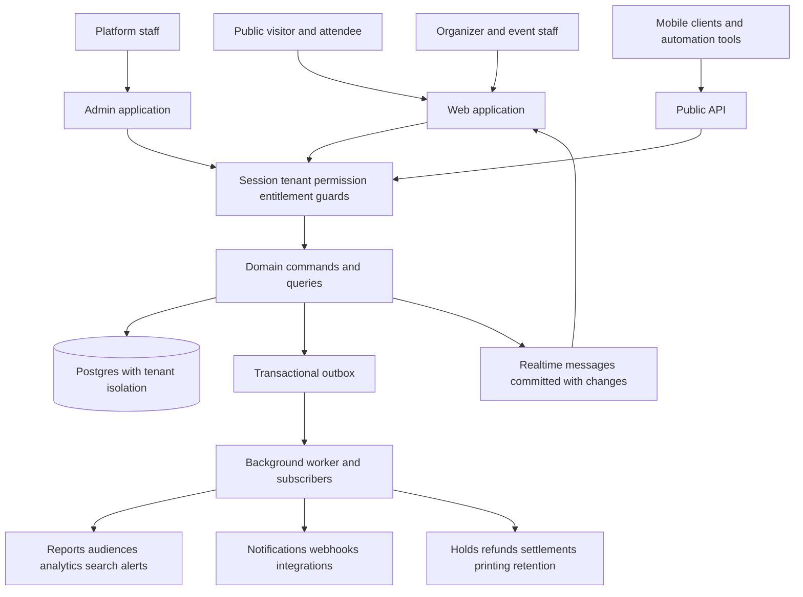

# Yayatoh full project feature and flow analysis

Yayatoh is an Event Operating System with shared commerce, identity, tenancy, communication and operational infrastructure. Weddings, galas, concerts, conferences, community events and agencies use different combinations of this infrastructure. The strongest architectural choice is that ticket sales, registration, seating and attendance converge on shared records. The largest delivery risks are incomplete production adapters, navigation that still exposes placeholder sections, and differences between online and offline rules.

This analysis covers the current local source on 8 October 2026. It maps every discovered page and endpoint file and all 46 domain modules. It is a static implementation analysis, not a certification that every button or integration works at runtime. Dependencies are absent locally, Node is 22.13.0 versus the required 24 or newer, and pnpm is 11.25.0 versus the pinned 12.6.0. Tests, database migrations and browser journeys were not executed. Existing UX findings are identified as historical evidence.

## Coverage and supporting inventories

| Area | Discovered count | Meaning |
|---|---:|---|
| Domain modules | 46 | Every directory in `packages/modules` |
| Web pages | 350 | Next.js `page.tsx` files, including public, account, organizer, token, fake-provider and development screens |
| Platform admin pages | 22 | Includes sign-in and refusal pages |
| Web endpoint files | 160 | Includes development, internal, webhook, file and public endpoints |
| Admin endpoint files | 4 | Next.js admin endpoints |
| Public API operations | 69 | Method/path entries in the committed OpenAPI document, separate from route-file counts |
| Detected domain operations | 1,264 | Lexically detected command/query definitions; not a count of unique user features |
| Source files indexed | 3,689 | TypeScript and JavaScript in apps, packages and tools, excluding boundary-gate canaries |
| Test source files indexed | 782 | Unit, integration and browser test files; existence does not imply passing tests |

The detailed deliverables are:

- [Panel inventory](panel-inventory.md): every page and Next.js endpoint, its direct domain imports, local server dependency chain, detected operations and direct guard calls.
- [Feature inventory](feature-inventory.md): all 46 modules, their declared connections, command/query definitions, feature rules, lifecycles, source indexes and detected event/table names.
- [API and worker inventory](api-and-worker-inventory.md): every committed public API operation, detected subscription and job names, and test source index.
- [Machine readable inventory](project-inventory.json): the same evidence for filtering and further audits.
- [Inventory generator](../../tools/project-analysis.mjs): regenerates these supporting inventories from source.

Import tracing is lexical, follows up to 12 local import levels and excludes shared composition roots from panel-specific package attribution. It can include imports used only by another action in a shared file and miss runtime fetches, dynamic dispatch, module reexports and parent-layout guards. Route groups are removed from displayed URLs; locale placeholders are retained. Dynamic routes represent multiple possible pages rather than one fixed screen. Table and operation metadata extraction is heuristic; the linked source is authoritative.

## Application architecture and feature connections

`apps/web` renders public pages and organizer screens and hosts server actions and several transport endpoints. `apps/admin` is the platform staff application with its own session cookie. `apps/api` mounts the shared Hono router at `/v1`; the web application also mounts it at `/api/v1`. `apps/worker` performs asynchronous delivery, projections and recurring operational work. `apps/zapier`, the SDK, Make app generation and n8n node generation expose a subset of the public contract to other tools.

The kernel executes commands through validation, entitlements, authorization, step-up authentication, idempotency, tenant transaction, handler, event emission, audit and output serialization. The platform package supplies database-backed command ports, outbox delivery, profiles, rate limits, signing, security and shared operational services. Domain modules own their tables and call exported interfaces rather than reaching into each other's schemas.

Source anchors: [kernel commands](../../packages/kernel/src/command.ts), [web composition](../../apps/web/src/server/ports.ts), [console guards](../../apps/web/src/server/console.ts), [worker composition](../../apps/worker/src/registry.ts), [worker schedules](../../apps/worker/src/main.ts), [public API](../../packages/api-v1/src/index.ts).

## Panels and their responsibilities

### Public discovery and branded tenant sites

The public surface includes the home page, event discovery, search, event details, event series, organizers, venues, blogs, content pages, pricing, features, contact, help, status, privacy and developer documentation. Tenant sites under `/t/[org]` provide an organization's own event catalog, content, contact and ticket access. Organizer public pages have their own `/organizers/[slug]` routes. Host resolution and branded-site helpers connect custom domains to the same tenant-scoped public data.

Publication does not directly make every module row public. Public event reads use allowlisted interfaces; marketplace listings are a projection; caches are org scoped; search is an additional index. A publication or moderation problem can therefore exist at the event, listing, cache or search layer. Diagnosis must identify which layer is stale.

### Account and identity

Organizer identity includes sign-in, email links, password recovery, social/SSO flows and account security. Privileged organizer roles require two-factor setup before entering the console. Attendee ticket access uses separate guest verification and host/org-scoped sessions. Speaker and exhibitor portal identities and scanner device tokens are additional credential types. A successful sign-in for one surface does not imply access to every other surface.

### Organization console

The sidebar groups organization work into Events, Audience, Money, Site and Settings. Its source is [org navigation](../../apps/web/src/lib/org-nav.ts).

| Group | Main panels | Connections |
|---|---|---|
| Events | Event list and creation, Command Center, alerts, series, templates, venues, seating library, venue portal, agency workspace | Events, profiles, templates, tenancy, billing, operational projections |
| Audience | People and contacts, segments, duplicate management, messages, campaigns, journeys, marketing analytics, support macros | CRM identity and consent, attendance participation, notification delivery, attribution |
| Money | Overview, payouts, sales by event, fees, finance, analytics, coupons, refund requests, disputes, charity | Snapshotted order amounts, payment ledger, settlement and reconciliation, donation compliance |
| Site | Public site settings, content, branding and media, help/content administration where allowed | CMS, marketplace, media, custom domains, public caches |
| Settings | Organization/team, sending setup, email templates, plan and usage, privacy, activity, API keys, webhooks, integrations, SSO, sandboxes | Membership, entitlements, delivery policy, external credentials, audit, API scopes |

Not all users see all panels. Collaborators assigned to specific events cannot open ordinary org-level pages. Agency access is based on live client grants and further permission checks. Features also depend on billing entitlements and applicable platform flags.

### Event console

The event shell groups work into Overview, Build and Run. Event pages cover overview, readiness, Command Center, details, dates, copying, teams, content, access, media, ticket/order management, attendees/imports, refunds/cancellation, seating, guests/RSVP, donations, registration, sessions, speakers, exhibitors, sponsors, badges, surveys, networking, virtual delivery, CE credits, onsite operations, assistance and analysis. Nested screens provide editors, imports, exports, record detail, invoices, print files and operational controls.

Seven profiles select navigation and vocabulary: wedding, gala, concert, conference, community, agency and other. Profiles are presentation choices; entitlements remain the capability gate. Wedding and gala enforce strict profile routes. Other profiles may leave unlisted routes reachable when the caller has permission. Event team roles further restrict sections and actions. Source: [profiles](../../packages/platform/src/profiles/index.ts) and [event layout](../../apps/web/src/app/[locale]/o/[org]/e/[event]/layout.tsx).

### Attendee and guest panels

Attendees encounter checkout, email verification, payment, order management, tickets, claims/transfers, waitlists, invoices, registration applications, group registration, forms, personal schedules, session enrollment, seat finder, assistance, surveys, live session polls/Q&A, networking, chat, virtual playback and certificate verification. Weddings additionally provide party RSVP, plus-one naming, private guest sites, guest collection, gallery/slideshow and day-of seating access.

These pages frequently use purpose-specific signed or random-token links. Some token pages are not reachable from the main navigation and need email or a created record. Their existence cannot be verified by crawling only the public homepage and sidebars.

### Onsite and participant portals

The Scan PWA supports device enrollment, signed manifests, local scanning, offline queues, sync, checkpoint scope, supervisor directives, kiosk modes, help requests and lead capture. Organizer onsite screens manage entrances, sessions, devices, staff, fraud and admissions. Badges have template, batch PDF, printer and kiosk flows. The event portal supports speaker/exhibitor profiles, tasks, sessions, proposals/reviews, staff/lead licenses and booth communication.

### Platform admin

Platform staff have tenant details, people, reports, provider health, access logs, API usage, security, categories, marketplace listings, charities, commission, messaging controls, signup codes, open-signup controls, incidents, legacy front-door routing and maintenance freeze. Tenant messaging detail is a separate subpanel. Sign-in and not-staff pages complete the 22 page-file count.

Admin, support and finance are different staff roles. Admin can change organization status, impersonate, operate the legacy front door and control maintenance. Support and finance receive narrower capabilities. Cross-tenant reads use audited platform access. Impersonation blocks money, export and delete command categories. Sources: [staff resolution](../../apps/admin/src/server/staff.ts), [staff permissions](../../apps/admin/src/server/staff-roles.ts), [admin shell](../../apps/admin/src/components/shell.tsx).

## Feature families across all modules

| Family | Modules | Feature responsibility and connection |
|---|---|---|
| Foundation | tenancy, billing, sso | Organizations, membership, invitations, event/client grants, domains, API keys, account standing, entitlements, subscriptions, agency billing, enterprise sign-in and SCIM |
| Event setup | events, venues, templates, cms, media | Lifecycle, dates/series, event teams/access/content, directory/quotes, safe copies, tenant content/help, storage and sanitized media |
| Identity and participation | crm, attendees, guests, forms | Organization contacts/consent/merges, event participation, private household guest data/RSVP, immutable conditional form versions |
| Commerce | ticketing, orders, payments | Inventory/holds, QR and holder revisions, distribution/transfers, checkout/waitlists/invoices/refunds/store credit/support, provider webhooks, ledger/settlements/disputes/reconciliation |
| Seating and social | seating, gallery, donations | Floor plans and materialized seats, sold versus assigned seats, finder/rules/revisions/channels; moderated guest media; gifts/receipts/matches/paddles/pledges/saved cards |
| Conferences | program, registration, badges, leads | Agenda/tracks/rooms/speakers/CFP/exhibitors/sponsors/tasks; eligibility/approval/groups/admission matrix/session enrollment; printing/kiosks; licensed lead retrieval |
| Onsite | checkin, assistance | Entrance/zone/session admission, offline sync, fraud and devices; request queue, assignment, activity and SLA |
| Communication | messaging, notifications, audiences, campaigns, automations, marketing | Threads/announcements; channel dispatcher and policy; live segments; campaign snapshots/scheduling; journey triggers/timed steps; links/UTM/attribution |
| Experience | engagement, surveys, reviews, virtual, ce | Polls/Q&A/networking/meetings/chat/scores; feedback; holder reviews; streams/watch time/Zoom; attendance-derived credit/certificates |
| Visibility | reports, analytics, alerts, command-center | Shared operational facts/projections, cross-event warehouse/explorer/attribution/scheduled reports, rule episodes/escalation, permission-aware dashboards/modes/TV |
| Distribution and external systems | marketplace, integrations, webhooks | Listings/search/enrollment/site settings/redirects/promotions; OAuth and sync/accounting/Slack/Zoom connectors; classified public events and endpoint delivery |
| Privacy and agency operations | privacy, agency, agency-ops, ai | Subject resolution/export/erasure; agency-owned client snapshots; client publications/fan-out/staff/handover; credit-metered drafting and matchmaking embeddings |

The feature inventory expands each row into its module rules, operations and source files. Package tiers run from low-level foundations to cross-module orchestration; higher-tier modules usually compose lower-tier exported functions, while same-tier/higher-tier dependencies are plugged through ports or asynchronous events.

## End to end feature flows

### Organization onboarding and event creation

Signup eligibility or a signup code → account/session → organization membership → onboarding/default profile → plan entitlements → event draft → details/timezone/venue/dates → applicable ticket, guest or registration setup → content/media/access → readiness → publish. Publication triggers listing/search updates and cache invalidation. A readiness checklist is a guidance surface; command validation and authorization remain separate gates.

Failure branches include signup disabled, invalid invitation/code, required two-factor/SSO, denied entitlement, incomplete event configuration and denied publish transition. Series creation and event creation can be composed in one transaction. Copies/templates produce a new draft and intentionally exclude live commercial/participation records.

### Ordinary ticket purchase

Public event target → private-event access check where applicable → ticket/date/seat selection → conditional answers and buyer identity → email verification when required → risk assessment → transactional inventory and seat hold → order with snapshotted totals/fees → provider payment creation → provider reference attached → verified deduplicated webhook → paid state → ticket/attendee issue → ledger and downstream events → ticket/order-link notification → reports/audience/analytics updates.

Zero-total purchases skip the external payment path. A browser redirect cannot mark an order paid. Payment failures, expired holds, late/orphaned outcomes, risk blocks and seat races have separate branches. Stock and seats must be inspected alongside the order; a failed payment does not by itself describe whether a hold has expired. Source: [public checkout actions](../../apps/web/src/app/[locale]/events/[slug]/actions.ts), orders/ticketing/payment modules.

### Ticket distribution and transfers

Paid ticket → purchaser order page or organizer attendee tools → claim links or recipient transfer → new holder/attendee identity → ticket reissue/revision change → notification/wallet update. An old QR revision must stop working. Revoking a link or cancelling a pending transfer changes the usable authorization. Buyer, current holder, contact and event attendee are different concepts.

### Refunds and cancellation

Buyer refund request or organizer action → policy based on purchase snapshot and current rules → permission/step-up → pending refund with idempotent provider key → provider result → order/refund/ledger updates → ticket voiding and stock/seat release → recipient notification → metrics/audience recalculation. Mass refund runs snapshot eligible orders and record resumable per-order work; disputes and organizer-collected payments have explicit skip cases. Credit notes/store credit form a distinct balance flow. Ticket cancellation without refund changes admission eligibility without moving money.

### Waitlist and recovered capacity

Sold-out ticket/type/date → queue entry → hold expiry/refund/stock release → worker selects entries under locks → time-limited offer with reserved quantity → signed offer checkout → purchase or offer expiry → capacity returned/reoffered. Conference registration maintains a type-level counter in addition to ordinary pass inventory, so its managed waitlist is orchestrated by registration.

### Seating and seat finder

Library/venue plan → event layout validation → publish/materialized seats → categories/blocks/channel rules → hold through checkout or assign organizer-managed guests → sold/assigned occupancy → plan locks at first sale → finder opens only by host opt-in → ticket, party/PIN, verified email or optional name lookup → seat/table/location result.

Purchased seats and organizer assignments use different records and release paths. Group placement is atomic. Later revisions must preserve held/sold seat identity. The advanced tools add best-available rules, channels, revisions, assignment constraints and shared venue plans. Seating reaches wedding guests through the configured occupant-directory port, avoiding a direct same-tier dependency.

### Wedding guests and RSVP

Party creation/import/collection → named guests and plus-one slots → primary party contact → sub-event invitations → signed RSVP link → attendance and conditional questions → private/sensitive answers sealed → reminders/history → seating assignment/finder → private guest website/gallery → day-of arrival tracking.

These guests are deliberately excluded from campaign audience creation. Dietary/accessibility/address data must remain out of public output, audit details and marketing. A plus-one placeholder consumes planning capacity even before being named. RSVP deadline, reopening and household invitation scope affect the available actions.

### Gala table purchase and giving

Table ticket type → table purchase → naming link → row lock and unnamed-seat selection → ticket reissue plus guest-party membership → seating/day-of flow. Tables refund as a whole under their refund-unit rules.

Donation campaign → giving level or amount → donation order → connected-account direct charge with zero platform application fee → outcome subscriber → gift record → receipt if applicable → donor notification and report. Charity verification and ticket fair-market value determine receipt behavior. Matching gifts, paddle raises and pledges add separate states. Saved cards require their own setup/consent; they are not inferred from a ticket payment. Pledge collection, invoice/offline payment, write-off and year-end statements extend the flow.

### Conference registration and applications

Registration type → admission/add-on matrix → hidden managed ticket types → eligibility/type capacity → named registrant selection → versioned multi-page forms → checkout → ordinary order and tickets → capacity/registrant subscribers → confirmed registration. Groups and plus-ones produce individually named registrants.

Manual approval instead creates a pending application without charging: application → organizer decision → approved capacity reservation → free confirmation or signed pay link. Invoice/pay-later creates tickets flagged with payment due and an invoice rather than a normal expiring unpaid hold. Registration setup activates the conference pack and checks event quotas.

### Agenda and session enrollment

Tracks/rooms/session types/speakers → session schedule and conflicts → live agenda or published snapshot → registrant schedule → optional-session enrollment and pick-one groups → atomic capacity claim → enrollment ticket access → door validation → attendance and dwell time → session analytics, feedback and CE rules.

Schedule conflicts are warnings. Capacity constraints and conflicting pick-one enrollment are hard guards. A published agenda snapshot can intentionally differ from edits to the working agenda. Optional-session enrollment is separate from event admission.

### Speakers and exhibitors

Invite/verification → event portal identity → speaker/exhibitor profile → sessions/tasks/deliverables/uploads → organizer review/approval → approved public program data. CFP adds submission, review, decision and draft-session creation. Exhibitor staff and lead licenses govern lead retrieval; booth chat adds visitor consent/moderation paths. Public program reads must exclude private task/contact/capacity data.

### Badge production

Versioned badge template → assignment to pass/type → preview → single print or queued batch → PDF/rendering or configured printer → job result/print log → reprint/operational status. Kiosk lookup and verification request a badge under kiosk policy. Outstanding invoice balances can block printing unless an authorized override is recorded.

### Online check in

Scanner/user/device context → checkpoint scope → QR signature/revision or short-code resolution → event/date/window/live-ticket rules → entrance admission or zone access or session gates → idempotent scan log → admission/session visit → fraud checks → realtime event → dashboard/report/audience/journey updates.

Entrances create event admissions; zones answer access without admitting; session doors create visits with enrollment, admission-level and capacity gates. Duplicate, void, wrong-event/date/checkpoint, balance-due and invalid outcomes are distinct. Undo retains history rather than deleting the original admission. Self-check-in flyers are a separate attendance-only path that intentionally does not apply normal door gates.

### Offline check in and reconciliation

Enrolled device → paged signed manifest and scope → local key/rule checks → local queue → heartbeat/reconnect → server sync with current device/scope checks → corrected scan times → per-event serialized application → earliest valid admission wins → duplicate/offline conflicts and fraud → realtime/projection updates.

Offline knowledge is a snapshot. The current manifest lacks payment-due status, and synchronized entrance admission does not have the same explicit balance check as online scanning. Offline room-capacity decisions also differ intentionally from the live shared counter. These differences need explicit product decisions and cross-device tests, especially for invoice-based conferences.

### Command Center and operational alerts

Domain facts/events → metric snapshots/time series and alert evaluation → role-specific widget loaders → pre-show/live/wrap-up mode → readiness, sales, admissions, capacity, device/staff status and assistance → actionable link to the owning panel → acknowledgement/snooze/resolution/escalation. Door roles cannot gain revenue through a custom layout. TV links expose operational counts without holder names or money.

Device and printer watchdogs, staff presence, payment failures and help SLAs depend on recurring worker schedules as well as event-triggered updates. A stopped worker can leave the application rendering while making these operational signals stale.

### Assistance

Guest ticket-help link or staff scan tool → event request with priority/location → shared queue → take/assign/start → notes and activity → resolve/cancel → realtime updates. Overdue requests feed alerts and Command Center widgets. Sensitive holder details should be accessed through authorized ticket helpers rather than pushed in realtime payloads.

### Audiences and campaigns

Purchases/admissions/ticket changes → participation/contact projections → safe segment DSL/template → preview/save audience → campaign content/brand → recipient snapshot with consent/suppression exclusions → test/schedule/send → fair worker release → notification policy recheck → delivery result → campaign analytics and alerts.

Segmentation and delivery permissions differ: marketing may build audiences without export access or finance access. Unknown legacy consent is not permission to send. Campaign counts must distinguish eligible, excluded, scheduled, released, delivered, failed and cancelled recipients. Pausing may allow an already released chunk to finish. Email opens are not tracked; clicks use tracked links.

### Journeys and transactional communication

Configured trigger and timed steps → paid order/check-in/event-time enrollment → journey run → scheduled action → due worker job → template expansion → consent/channel/quiet-hours policy → send/result → next step or failure signal. Event changes and cancellation can reschedule/cancel work. Transactional ticket mail is separate from an organizer's journey confirmation, so both may be sent when intentionally configured.

### Surveys reviews and live engagement

Ended event/session → eligible person deduplication → invitation → signed survey form → one response per person → results/export/contact timeline. Reviews require a buyer still holding a live ticket after its date ends, then moderation/public display.

Live-session enablement → participant key → poll vote or question/upvote → moderation → approved public realtime feed → presenter/display link. Networking is opt-in: profile → directory/matching → connection/meeting request → response → chat, block/report and retention. Networking consent and moderation have their own rules; access to event tickets alone is not consent to expose a networking profile.

### Virtual attendance and continuing education

Event delivery mode and ticket access → session stream/provider → ticket-scoped viewing authorization → signed playback → heartbeat minutes → virtual attendance event/checkpoint → combined attendance evidence → CE calculation → revision/withdrawal-aware certificate → PDF/mail/public verification.

Zoom join/leave webhooks are raw-body verified and deduplicated; provider choice/backup ingest is a separate control. CE combines door dwell, watch-minute and Zoom evidence according to session rules. Certificate legal wording remains marked pending counsel in source.

### Analytics and financial reporting

Committed events → operational reports projector and warehouse ingestion → deduplicated event/snapshot updates → dashboards → explorer/saved views/export → scheduled report period/run → PDF/notification. Attribution consumes tracked landing/click paths and supports first/last/linear models. Money queries require finance permission independently of ordinary counts.

Operational reports, warehouse dashboards and payment reconciliation are different read models. A mismatch should be investigated through source facts, projector lag, warehouse sync/backfill state and ledger references rather than assumed to be a chart defect.

### Integrations API and webhooks

Org API key/session → tenant resolution and scope/rate/quota check → allowlisted command/query → idempotent output or structured problem. Content reads support ETag/cursor pagination. Device-token scanner routes form a narrower API path. Public webhooks classify only approved thin events and send through the configured publisher.

Integration connection/OAuth → allowlisted versioned mappings → leased pull/push sync → record links and loop guards → command writes → retries/errors inbox. CRM connectors, audience tools, Slack, Zoom and accounting use different connector capabilities. External unsubscribes become local suppressions. Accounting produces summary journals with mappings and reversal/repost behavior. Make/n8n/Zapier build on `/v1` plus REST hooks.

### Agencies

Client grants agency access → live grant check → agency-owned client/event snapshots → client navigation within granted scope. Agency v2 additionally needs the platform flag: publish template/brand → client receive/apply; fan-out campaign → recipient client campaign; staff assignment → event access; detach/handover → revoke/update client relationship.

Agency billing requires client acceptance. Commission applies only to the documented platform-managed funds flow, with held/released/reversal/receivable states mirrored into the agency ledger. Revocation must affect both live access and downstream snapshots/billing behavior.

### Privacy and account lifecycle

Verified data-subject request → subject resolution → contributors from all personal-data modules → export or erasure → audit/receipt → downstream media/integration handling. Contact merge moves module-owned references transactionally through registered owners. Financial retention and anonymous attendance/reporting need their own preservation rules. Suspension/termination, billing read-only states and platform freeze affect writes independently of normal page access.

## Findings supported by source

| Priority | Finding | Effect and evidence |
|---|---|---|
| High | Production AI drafting and embeddings are incomplete | `anthropicDrafter` throws unavailable errors for draft, compose and embed. Supplying an API key does not make it work. [Source](../../packages/modules/ai/src/drafter.ts#L179) |
| High | Production SSO has no real identity-provider adapter in the supplied runtime | Real DNS/metadata fetching is configured but `idp` is null; enterprise sign-in cannot complete through this runtime until implemented/configured. SCIM should be assessed separately. [Source](../../packages/modules/sso/src/config.ts#L9) |
| High | Online and offline invoice-balance admission rules differ | Online entrance scan rejects an unpaid invoice ticket as `balance_due`; manifest rows omit the flag and sync has no matching check. This can admit a ticket offline that would be refused online. Static finding; reproduce before changing the operational policy. [Online scan](../../packages/modules/checkin/src/scan.ts#L151), [manifest and sync](../../packages/modules/checkin/src/devices.ts) |
| Medium | Profile navigation still contains placeholder event sections | The dynamic section route renders a coming-soon state; readiness lists `rsvp`, `messages`, `branding`, `communications`, `libraries` as placeholders. Real RSVP exists under `guests/rsvp`, so the wedding `rsvp` entry/readiness rule warrants route alignment. [Fallback page](../../apps/web/src/app/[locale]/o/[org]/e/[event]/[section]/page.tsx), [readiness](../../packages/modules/command-center/src/domain/readiness.ts#L62) |
| Medium | Pricing and operational defaults are still owner decisions | Billing catalogs have inactive placeholder prices; messaging/gallery quotas and commission defaults are provisional. Presence of plan/settings panels does not establish a final commercial offering. [Billing catalog](../../packages/modules/billing/src/catalog.ts), [owner inbox](../owner-inbox.md) |
| Medium | Gallery video upload adapter is a stub | Supported gallery video links are YouTube/Vimeo. Gallery Cloudflare upload is not wired; this is separate from virtual-session streaming providers. [Source](../../packages/modules/gallery/src/ports.ts#L116) |
| Medium | Integrations depend on configured production OAuth infrastructure | Production without Nango returns no integration auth provider. Dev fake success does not establish a live connector. This is a configuration dependency, not evidence that every connector is broken. [Source](../../packages/modules/integrations/src/auth/registry.ts#L15) |
| Medium | Main project status documentation is stale | README describes Phase 0/planned implementation and Vercel/Fly/Neon while current code has extensive later modules and deployment scripts for self-hosting. It can mislead setup and readiness assessment. [README](../../README.md), [guide](../../CLAUDE.md), [deployment runbook](../runbooks/deploy-contabo.md) |
| Follow up | Existing UX sweep has incomplete token/flag coverage and recorded mobile issues | The backlog states 96 detail pages were excluded and agency-v2 pages were gated. It records analytics/admin horizontal overflow, raw identifiers, duplicate actions and a fixture-related admin 500. These are historical reports, not newly reproduced failures. [UX backlog](../ux/backlog.md) |
| Release dependency | Certificate and agreement wording need completion | Certificate source explicitly labels legal copy pending counsel; speaker agreement defaults also require review. This analysis does not assess legal validity. [Certificate copy](../../packages/modules/ce/src/legal/certificate-copy.ts), [program schema](../../packages/modules/program/src/schema-portal.ts) |

The pending decisions above do not block analyzing the project. No application fixes, provider configuration, production access or deployment changes were made.

## Connections that need runtime verification

| Journey or boundary | Required scenario and expected relationship |
|---|---|
| Tenant isolation | Same identifiers across two orgs never allow another org's rows, cache entries, files or realtime messages |
| Roles and profiles | Owner, finance, marketing, collaborator, door staff and planner see/open only authorized panels; hidden direct links are tested separately |
| Checkout races | Last ticket/seat/date purchased concurrently; only valid stock claims commit |
| Payment replay | Duplicate/out-of-order webhook, timeout before provider reference attachment, hold expiry then late payment; no double issue or charge |
| Transfers | Old QR/wallet revision denied after transfer; claims and attendee identity update consistently |
| Refunds | Partial/full/refused/provider-timeout/mass-refund paths release the correct stock and seats and reconcile the ledger |
| Waitlists | Freed capacity goes to the line, offer expiry returns it once, registration type capacity stays correct |
| Invoice admissions | Unpaid/part-paid/paid/void invoices tested at online entrance, offline entrance, session door and badge kiosk |
| Registration | Approval/group/+1/invoice/form-resume/session enrollment update the same ticket/attendee records |
| Agenda publication | Working edits versus published snapshot, enrollment changes, live session data and public agenda remain intentionally consistent |
| Offline multi-device sync | Clock skew, duplicate QR, revoked device, changed scope, stale revision, session capacity and replayed batch converge as specified |
| Guest privacy | RSVP and finder token isolation, gallery password checks, encrypted answers, exports and marketing exclusion |
| Campaign policy | Consent withdrawn after snapshot, bounce/suppression, quiet hours, paused/cancelled chunks, retries and cross-org scheduler fairness |
| Automation time | Event postponement/cancellation, timezone/DST and series scope reschedule or cancel the intended steps |
| Live operations | Worker outage/restart, device/watchdog transitions, presence expiry, help SLA, alerts and realtime reconnect recover without leaks |
| Virtual and CE | Overlapping watch/door/Zoom evidence, replayed webhooks, certificate recalculation/withdrawal and provider switch |
| Agency access | Revocation between page load and action, finance opt-in, fan-out retries, detach and commission reversals |
| Integration sync | OAuth expiry, leased worker crash, pull/push loop guard, conflict and external unsubscribe/erasure propagation |
| Privacy | Contributor completeness, sealed file export, erase preserving financial invariants, contact merge/undo across references |
| Public publication | Event publish/unpublish, organization suspension, listing moderation, projection/cache/search revalidation |
| Legacy migration | Front-door route ownership, frozen `/api/v2` golden contracts, reverse ETL, freeze exceptions and rollback rehearsal |

The repository already contains unit, database-isolation/integration, Playwright, contract and performance/security tooling for many of these boundaries. Their source index is included; a passing status must come from execution in the supported environment.

## Practical assessment

The implementation has broad feature coverage and a coherent shared-data architecture. Most feature interconnections are concrete: registration uses ordinary tickets, money flows through orders/payment ledgers, operational events feed dashboards and audiences, consent is rechecked during delivery, and cross-module guest/session access is explicitly connected at composition roots.

The project should be evaluated as three separate readiness dimensions: implemented source, configured production capability and verified runtime behavior. It has substantial source coverage. AI/SSO and some optional media/provider capabilities need implementation or production wiring; commercial defaults and legal copy remain decisions; end-to-end correctness requires the supported local/staging stack. The highest-value next verification is commerce and registration through ticket issue, online/offline admission, refunds and ledger reconciliation, followed by role/profile navigation and asynchronous worker recovery.
